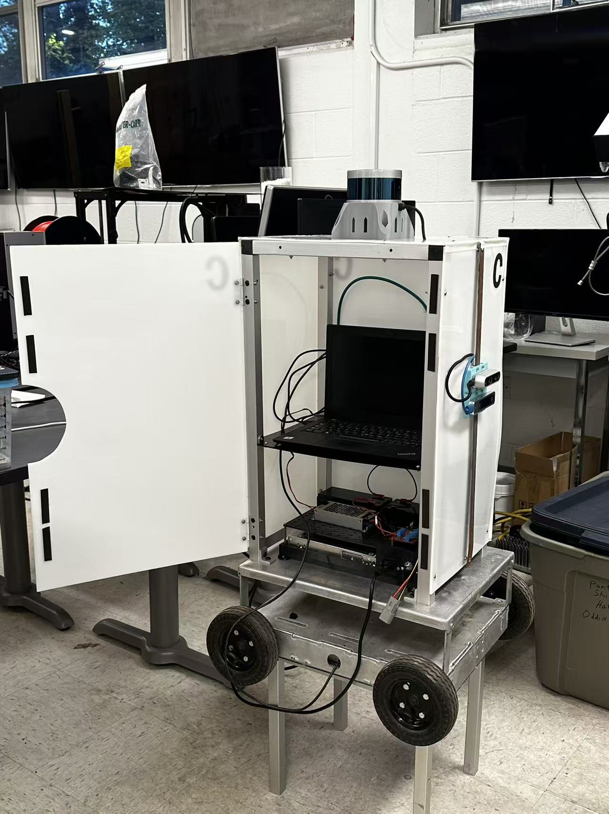

# MAE6270-FridgeBot

Team: Ethan Cao, Eric He, Ray Fang, Katherine Craig

Fridgey is a four-wheel robot controlled through ROS 2.



## Prepare the computers

Use ROS 2 Jazzy on both computers.
The commands below use `~/MAE6270-FridgeBot` as the project folder.
Replace this path if your folder differs, for example `~/human_machine_interface`.

1. Put the current project files on both computers.
2. Connect both computers to the same Wi-Fi network.
3. Connect the Arduino to the robot computer through USB.
4. Stop previous copies of the control programs.
5. Close Arduino IDE before motor operation.

The network must permit ROS 2 traffic between the computers.
Use one control mode at a time: joystick control or motion commands.
Both modes publish on `/cmd_vel`.

## First setup

Install the joystick package on the **base computer**:

```bash
sudo apt update
sudo apt install ros-jazzy-joy
```

Install the serial package on the **robot computer**:

```bash
sudo apt update
sudo apt install python3-serial
```

Keep `setup_ros_env.sh` beside the start scripts.
Run once on **each computer**:

```bash
cd ~/MAE6270-FridgeBot
bash setup_ros_env.sh
```

This command creates or replaces `ros_env.sh` in the same folder.
Run it again if `ros_env.sh` is missing.
The environment file loads ROS 2 Jazzy and sets these values:

- `ROS_DOMAIN_ID=3`
- `ROS_AUTOMATIC_DISCOVERY_RANGE=SUBNET`
- `ROS_LOCALHOST_ONLY` is unset

The Bash start scripts load this file automatically.
For manual Python or ROS commands, use `source ros_env.sh` once in each new terminal.
`bash ros_env.sh` does not retain its settings in the current terminal.

## Prepare the Arduino

Upload the program once. Upload again only after a code change or board replacement.

1. Stop `start_robot.sh` before an upload.
2. Close **Serial Monitor**.
3. Close **Serial Plotter**.
4. Install `DualVNH5019MotorShield` through Arduino IDE Library Manager, if necessary.
5. Open `week7_motor_control/week7_motor_control.ino`.
6. Select **Arduino Uno**.
7. Select the Arduino USB port.
8. Click **Upload**.
9. Wait for a successful upload.
10. Close Arduino IDE.

The Arduino runs its saved program without Arduino IDE.

## Start the robot computer

Use this command for either control mode.
Switch on the motor power before you start the interface.

```bash
cd ~/MAE6270-FridgeBot
bash start_robot.sh
```

Keep this terminal running.
Wait for these messages:

```text
Ready on /dev/ttyACM0; waiting for /cmd_vel
Arduino: READY
```

The default port is `/dev/ttyACM0`.
To find the actual port, run in another terminal:

```bash
python3 -m serial.tools.list_ports -v
```

For a different port, use `bash start_robot.sh /dev/ttyACM1`.
Keep Serial Monitor closed while the motor interface runs.

## Base computer: joystick control

1. Connect the joystick to the base computer.
2. Set the stick to its centre position.
3. Stop `motion_command.py` if it is running.

For WSL, attach the joystick USB device to Ubuntu first.
To find the joystick device ID, run:

```bash
cd ~/MAE6270-FridgeBot
source ros_env.sh
ros2 run joy joy_enumerate_devices
```

Start joystick control:

```bash
cd ~/MAE6270-FridgeBot
bash start_base.sh
```

Keep this terminal running.
The default joystick ID is `0`.
For joystick ID `1`, use `bash start_base.sh 1`.

The script starts both base programs:

| Program | Function |
|---|---|
| `joy_node` | Publish joystick input on `/joy` with a 20 Hz repeat rate |
| `week8_joystick_teleop.py` | Receive `/joy` and publish velocity commands on `/cmd_vel` at 5 Hz |

The axis and speed settings are in `config/week8_joystick.yaml`.
Move the stick to request movement.
Release the stick to request a stop.
Press **Ctrl+C** to stop both joystick programs.

## Base computer: motion commands

1. Stop `start_base.sh` with **Ctrl+C** if it is running.
2. Keep `start_robot.sh` running on the robot computer.
3. Open a terminal on the base computer.
4. Run:

```bash
cd ~/MAE6270-FridgeBot
source ros_env.sh
python3 -m wheel_control.motion_command
```

Enter commands at the `motion>` prompt.
Distances use metres. Turn angles use degrees.

| Command | Function |
|---|---|
| `forward 0.1` | Add a forward movement request of 0.1 m |
| `backward 0.1` | Add a backward movement request of 0.1 m |
| `left 10` | Add a left turn request of 10 degrees |
| `right 10` | Add a right turn request of 10 degrees |
| `start` | Execute the queued sequence |
| `cancel` | Clear the queue before execution |
| `help` | Display the command instructions |

For example, enter:

```text
forward 0.1
start
```

Adding a movement only puts it in the queue. Type `start` to begin execution.
The program exits after the sequence. Run it again to enter another sequence.
Press **Ctrl+C** to stop the motion program.

This program estimates distance and angle from elapsed time.
Calibrate the motor speed before distance tests.
The requested RPM does not confirm the actual wheel RPM.

## Optional: display velocity commands

Open another terminal on either computer:

```bash
cd ~/MAE6270-FridgeBot
bash monitor_cmd_vel.sh
```

This script displays `/cmd_vel` continuously.
It is not required for motor control.
During forward movement, `linear.x` must be greater than zero.
After the movement ends, the velocity values must return to zero.
Press **Ctrl+C** to stop the display.

## Check the robot connection

1. Stop the current robot script with **Ctrl+C**.
2. Keep Arduino IDE closed.
3. Start the interface with diagnostic output:

```bash
cd ~/MAE6270-FridgeBot
bash start_robot.sh /dev/ttyACM0 -p diagnostics:=true
```

Use the actual Arduino port if it differs.
During a control command, check these messages:

| Message | Meaning |
|---|---|
| `ROS RX: ...` | The motor interface received a changed velocity request |
| `Serial TX: M ...` | The complete command was written to the USB serial port |
| `Arduino: OK` | The Arduino accepted a command; wheel movement is not confirmed |
| `Arduino: FAULT` | The motor shield reported a fault |
| `Arduino: ERR` | The Arduino rejected a command |
| `Arduino: TIMEOUT` | The Arduino stopped drive after a serial command gap |

Repeated `OK` replies appear at most once per second.
To return to normal logging, stop this script before you run `bash start_robot.sh`.

If the Arduino port gives `Permission denied`, run on the **robot computer**:

```bash
sudo usermod -aG dialout "$USER"
```

Log out of the robot computer. Log in again before you start the interface.

## Camera and LiDAR dashboard

The robot computer sends sensor messages. The base computer displays them.
The dashboard does not start the camera or the Velodyne driver.
Motor control scripts are not required to display sensor data.

### Files required on each computer

Keep these files together in the project folder on the specified computer:

| Computer | Files |
|---|---|
| Robot | `start_camera.sh`, `direct_camera.py`, `ros_env.sh` |
| Base | `fridgebot_dashboard.py`, `dashboard_window.py`, `dashboard_camera_node.py`, `dashboard_lidar_panel.py`, `read_cloud_xyz.py`, `fridgebot_dashboard.ui`, `ros_env.sh` |

If `ros_env.sh` is missing, use `setup_ros_env.sh` as specified in **First setup**.

### Install the sensor display packages once

Run on the **robot computer**:

```bash
sudo apt update
sudo apt install python3-opencv python3-numpy ros-jazzy-cv-bridge v4l-utils
```

Run on the **base computer**:

```bash
sudo apt update
sudo apt install python3-pyqt5 python3-numpy ros-jazzy-cv-bridge ros-jazzy-sensor-msgs-py
```

### Robot computer: start the camera

1. Connect the USB camera to the robot computer.
2. Close other programs that use this camera.
3. Find the camera device:

```bash
v4l2-ctl --list-devices
```

4. Start capture in a separate terminal:

```bash
cd ~/MAE6270-FridgeBot
bash start_camera.sh
```

The script loads `ros_env.sh` automatically. The default camera is `/dev/video0`.
For a camera at `/dev/video2`, use this command instead:

```bash
bash start_camera.sh /dev/video2
```

Keep the camera terminal open.
The `/direct_camera` node publishes images on `/image_raw`.
It prints the image rate approximately every five seconds.

### Robot computer: start the LiDAR

Start the team's existing Velodyne driver and point cloud converter in another terminal.
Load `ros_env.sh` before the team's LiDAR start command.
Load the LiDAR workspace setup file if that driver requires it.
The converter must publish `/velodyne_points` with type `sensor_msgs/msg/PointCloud2`.

This repository does not contain the team's Velodyne launch command.
Use the working command for your sensor model.
The camera display can operate while the LiDAR is stopped.

### Base computer: start the dashboard

1. Connect the base computer to the robot network.
2. Open a terminal on the base computer.
3. Run:

```bash
cd ~/MAE6270-FridgeBot
source ros_env.sh
python3 fridgebot_dashboard.py
```

Run only `fridgebot_dashboard.py`. It imports the other dashboard modules automatically.
Do not run `start_camera.sh` on the base computer when the camera is attached to the robot.

| Panel | Topic | Display |
|---|---|---|
| Left | `/image_raw` | Live camera image |
| Right | `/velodyne_points` | Current 3D points projected onto the XY plane |

The LiDAR panel shows all heights together. It does not accumulate a map.
The frame name appears above the LiDAR panel. Positive X points up; positive Y points left.
The default view extends 5 m from the frame origin to each plot edge.
To increase this distance to 10 m, use this command instead:

```bash
python3 fridgebot_dashboard.py --ros-args -p lidar_view_radius_m:=10.0
```

Press **F11** to enter full screen. Press **Esc** to leave full screen.
The **ENABLE MOTORS** and **STOP MOTORS** buttons are disabled. Motor control is not connected to this dashboard.
Use the existing joystick or motion command program for motor control.

### Check a missing sensor display

Open another terminal on the **base computer**:

```bash
cd ~/MAE6270-FridgeBot
source ros_env.sh
ros2 topic info /image_raw --verbose
ros2 topic info /velodyne_points --verbose
```

Check for at least one publisher on each active sensor topic.
Both computers must use `ROS_DOMAIN_ID=3`.
If a topic is missing, check its robot program and the network connection.
These check commands are not required for normal display operation.

The dashboard clears old sensor data after two seconds without new messages.
Close the dashboard window to stop the display.
Press **Ctrl+C** in the robot camera terminal to stop capture.
Stop the Velodyne program separately when it is no longer required.

## Stop the system

1. Release the joystick or stop the motion program.
2. Check that the robot stops.
3. Press **Ctrl+C** in the base control terminal if it is still running.
4. Press **Ctrl+C** in the robot interface terminal.
5. Stop any camera or message display scripts with **Ctrl+C**.
6. Switch off the motor power.
