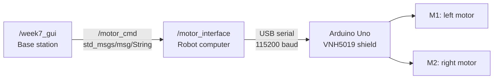

# MAE6270-FridgeBot
---
Team Roster: Ethan Cao, Eric He, Ray Fang, Katherine Craig
---
## Fridgey:
- Meet fridgey, a teleoperated four wheeled robot via ROS2 software


## Week 7 wheel motor control

The base station runs `/week7_gui`. The robot computer runs `/motor_interface`.
The GUI publishes `std_msgs/msg/String` messages on `/motor_cmd`.
The robot node subscribes to this topic and forwards commands to the Arduino through USB serial at 115200 baud.
The Arduino program is not a ROS 2 node.



### Source files

Each class and shared function has its own Python module. Methods stay with their class.

| File | Purpose |
|---|---|
| `week7_gui.py` | Start the GUI application |
| `robot_motor.py` | Start the robot interface node |
| `wheel_control/gui_node.py` | Define the GUI publisher node |
| `wheel_control/wheel_control_window.py` | Load the Designer form and handle controls |
| `wheel_control/motor_interface.py` | Define the ROS-to-serial interface node |
| `wheel_control/motor_settings.py` | Define the shared settings class |
| `wheel_control/parse_motor_command.py` | Check command syntax and limits |
| `wheel_control/format_motor_command.py` | Build a command containing both motor values |
| `week7_gui.ui` | Store the visual layout from Qt Designer |
| `week7_motor_control/week7_motor_control.ino` | Run the Arduino motor controller |

### Command format

Use `M <left> <right>`. For example, `M 100 -100` requests opposite drive directions.
Each value must be between -400 and 400. These are motor drive commands, not angles or measured RPM.
`M 0 0` removes drive from both motors. The wheels can coast; this command does not apply active braking.
M1 controls the left side and M2 controls the right side.
The Arduino direction constants can reverse either side if its wiring requires that change.

### Arduino setup

1. Keep the wheels clear of the floor for the first test.
2. Install the Pololu `DualVNH5019MotorShield` library through Arduino IDE Library Manager.
3. Open `week7_motor_control/week7_motor_control.ino`.
4. Select the Arduino Uno and its port.
5. Upload the program.
6. Set Serial Monitor to 115200 baud and Newline.
7. Send `M 0 0`. The response must be `OK`.
8. Close Serial Monitor before starting the robot node.

### Robot computer

Copy `robot_motor.py` and the complete `wheel_control` folder to the robot computer.
Install `python3-serial` if necessary. Run these commands from the repository folder:

```bash
source /opt/ros/jazzy/setup.bash
python3 robot_motor.py --ros-args -p port:=/dev/ttyACM0
```

Replace `/dev/ttyACM0` with the actual Arduino port if necessary.

### Base station

Keep `week7_gui.py`, `week7_gui.ui`, and the complete `wheel_control` folder together.
Install `python3-pyqt5` if necessary. Run these commands from the repository folder:

```bash
source /opt/ros/jazzy/setup.bash
python3 week7_gui.py
```

Use the same team `ROS_DOMAIN_ID` on both computers and in each terminal.
Both computers must be on a network that permits ROS 2 discovery and topic traffic.
The GUI enables its controls when it discovers the robot subscriber.
The controls return to zero when that subscriber disappears.

### Timing and stop behavior

The GUI publishes both targets every 100 milliseconds.
The Stop button sets both sliders and number displays to zero, then publishes `M 0 0` immediately.
The robot node forwards fresh targets immediately and repeats them every 100 milliseconds.
If ROS commands stop for 500 milliseconds, the robot node replaces its targets with zero.
If serial commands stop for 500 milliseconds, the Arduino removes motor drive.
Timer scheduling and communication delays can extend the response time.
A motor shield fault removes drive and stays active until the Arduino restarts.

The GUI connection message confirms that a ROS subscriber is visible.
It does not confirm motor motion, encoder speed, or the motor shield state.
Arduino responses appear in the robot terminal.
ROS 2 also creates the standard `/rosout` and `/parameter_events` topics.
